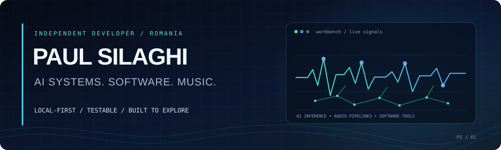

  

  
  

I build things around two interests that keep crossing over: **local AI systems** and **music software**. Lately that has meant running agents on local models, building practical tooling, and experimenting with ways to make music workflows less manual.

## Projects

<table>
  <tr>
    <td width="33%" valign="top">
      <h3><a href="https://github.com/DrFoxi14/openclaw-setup">OpenClaw Setup</a></h3>
      
A documented local-first AI-agent setup: Ollama inference, tool integrations, persistent memory, and a Python test suite.

      LOCAL AI · AGENTS · PYTHON
    </td>
    <td width="33%" valign="top">
      <h3><a href="https://github.com/DrFoxi14/worship-stems">Worship Stems</a></h3>
      
A research prototype for turning stereo recordings into rehearsal-ready stems, clicks, guide tracks, and production assets.

      AUDIO · SIGNAL PROCESSING
    </td>
    <td width="33%" valign="top">
      <h3><a href="https://github.com/DrFoxi14/midi-mp4">MIDI-MP4</a></h3>
      
A local SATB workstation for importing scores, creating separate MIDI parts, previewing them, and rendering score videos.

      MUSIC SOFTWARE · MIDI
    </td>
  </tr>
</table>

## Tools I work with

  
  
  
  
  
  

## GitHub activity

  
  

---

Interested in local-first systems, practical experiments, and the details that make software reliable.

